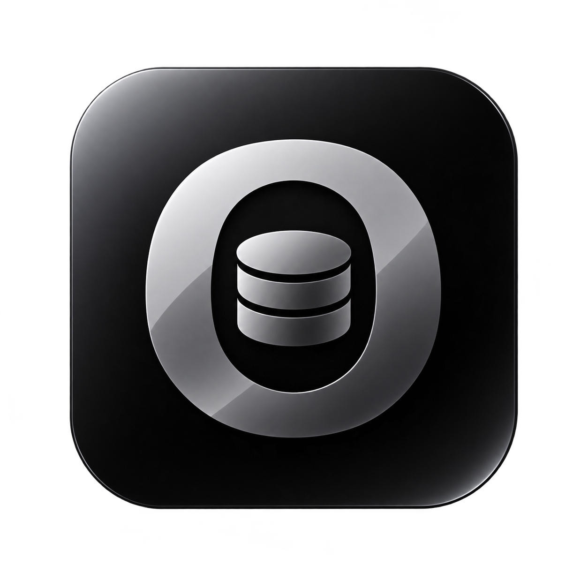

<p align="center">
  
</p>

<h1 align="center">OxtanDB</h1>

<p align="center">
  <strong>Fast, safe, zero-bloat command-line tool for MySQL.</strong>
</p>

<p align="center">
  <a href="LICENSE"></a>
  <a href="pyproject.toml"></a>
</p>

---


OxtanDB is a command-line tool for inspecting, querying, and managing MySQL databases. Built from scratch with a security-first architecture, sub-second startup latency (<0.20s), and clean stdout/stderr streaming suitable for piping into tools like `jq` and `cut`.

---

## Highlights

- **Instant Startup**: Launches in under 0.20 seconds with lazy-loaded drivers and zero heavy startup dependencies.
- **SQL Injection Defense**: Every table and column identifier is validated against `^[a-zA-Z0-9_]+\Z` and quoted with backticks. All values use parameterized queries (`%s`).
- **Read-Only by Default**: Queries run in `SET SESSION TRANSACTION READ ONLY` mode. Destructive queries require `--write` and interactive confirmation.
- **Credential Protection**: No `--password` command-line flag. Passwords are typed via masked prompts (`getpass`) and stored in user-isolated `~/.oxtan/profiles.json` with `0o600` permissions.
- **Pipeline-Friendly**: Pure data goes to `stdout`, diagnostic banners and errors go to `stderr`. `oxtan peek users --format json | jq .` works out of the box.
- **Zero Heavy Bloat**: Native table, JSON, and CSV formatters without Pandas or external rendering libraries.

---

## Installation

### Recommended: Using `pipx`
```bash
pipx install git+https://github.com/Elitsuv/Oxtan.git
```

### Using standard `pip`
```bash
pip install .
```

### Run without installation
```bash
python -m oxtan --help
```

---

## Quickstart (30 Seconds)

### 1. Add a Database Profile
```bash
oxtan add-db dev --host 127.0.0.1 --port 3306 --user root --database my_service
```
*(You will be securely prompted for your password)*

### 2. Check System Health
```bash
oxtan doctor
```


### 3. List and Describe Tables
```bash
# List all tables (alias: t)
oxtan tables

# Inspect column schema (alias: s)
oxtan schema users
```


### 4. Peek and Count Data
```bash
# Preview first 5 rows (alias: p)
oxtan peek users --limit 5

# Quick row count
oxtan count users
```


### 5. Run Queries
```bash
# Read-only query (alias: q)
oxtan query "SELECT id, email, created_at FROM users WHERE active = %s" --param 1

# Export results as JSON or CSV
oxtan query "SELECT id, email FROM users" --format json > users.json
oxtan query "SELECT id, email FROM users" --format csv > users.csv

# Modify data with explicit confirmation
oxtan query "UPDATE users SET active = 0 WHERE id = 42" --write
```


---

## Command Reference

| Command | Alias | Description | Output Formats |
| :--- | :--- | :--- | :--- |
| `add-db` | - | Configure a new MySQL connection profile | - |
| `use` | - | Switch the active connection profile | - |
| `dbs` | - | List all configured database profiles | - |
| `current` | - | Display currently active profile | - |
| `tables` | `t` | List all tables in active database | table, json, csv |
| `schema` | `s` | Inspect column structure and types of a table | table, json, csv |
| `peek` | `p` | Preview the first N rows of a table | table, json, csv |
| `count` | - | Count total rows in a table | text |
| `query` | `q` | Execute SQL query (read-only by default) | table, json, csv |
| `doctor` | - | Run environment and connectivity diagnostics | text |
| `about` | - | Display ASCII doodle mark and quick cheatsheet | text |

### Global Flags

- `--version`: Show tool version (`oxtan 0.1.0`) and exit.
- `--quiet`: Suppress decorative banners, hints, and informational messages.
- `--no-color`: Disable ANSI color codes (also triggered by `NO_COLOR=1`).
- `--debug`: Show full Python stack traces on errors (default shows one clean error line with actionable fix hint).

---

## Output Redirection and Piping

OxtanDB strictly separates output channels:
- **`stdout`**: Query results, tables, JSON, CSV, row counts.
- **`stderr`**: Connection status, banners, warnings, errors.

This enables direct shell composition:
```bash
# Pipe formatted JSON directly into jq
oxtan query "SELECT id, name FROM users" --format json | jq '.[] | select(.id > 10)'

# Stream CSV into standard Unix tools
oxtan peek transactions --format csv | cut -d',' -f2
```

---

## Performance & Startup Benchmarks

OxtanDB is engineered for instant CLI feedback with zero heavy dependencies at startup:

| Metric | Legacy Prototype | OxtanDB v0.1.0 | Improvement |
| :--- | :--- | :--- | :--- |
| **CLI `--help` Latency** | ~5,900 ms (5.90s) | **~178 ms (0.18s)** | **33x faster** |
| **Peak Startup Memory** | ~65 MB | **~12 MB** | **5.4x lighter** |
| **Startup Imports** | Eager Pandas & Driver | **Lazy Driver Loading** | Clean architecture |

*Measured on Python 3.13.0 on Windows 11 AMD64 using `python -X importtime main.py --help`.*

---

## Architecture & Security

- **SQL Injection Defense**: Every table and column identifier is strictly validated against `^[a-zA-Z0-9_]+\Z` (max 64 characters) and quoted with backticks. All values use parameterized `%s` placeholders.
- **Read-Only Session Enforcement**: Queries run under `SET SESSION TRANSACTION READ ONLY` by default. Write queries require `--write` and explicit confirmation.
- **Credential Storage**: Passwords are saved in `~/.oxtan/profiles.json` with restricted permissions (`0o600` on POSIX systems; user-profile folder ACL isolation on Windows).
- **User Guide**: For complete command references, piping examples, and workflows, see [docs/USER_GUIDE.md](docs/USER_GUIDE.md).

---

## Dependencies & Driver

- **Default Driver**: `mysql-connector-python>=8.0.0` (pure-Python official connector supporting MySQL 8.0+ `caching_sha2_password` out of the box).
- **Driver License**: Licensed under GPLv2 with the Oracle Universal FOSS Exception (FLOSS Exception), which permits distribution and use alongside Apache-2.0 software without GPL copyleft contamination.
- **Alternative**: PyMySQL (MIT) is also compatible; note that it requires the external `cryptography` package for `caching_sha2_password`.

---

## Disclaimer

OxtanDB is an independent open-source project and is not affiliated, endorsed, or sponsored by Oracle Corporation or MySQL. MySQL is a registered trademark of Oracle Corporation.

---

## License

This project is licensed under the [Apache License, Version 2.0](LICENSE).
